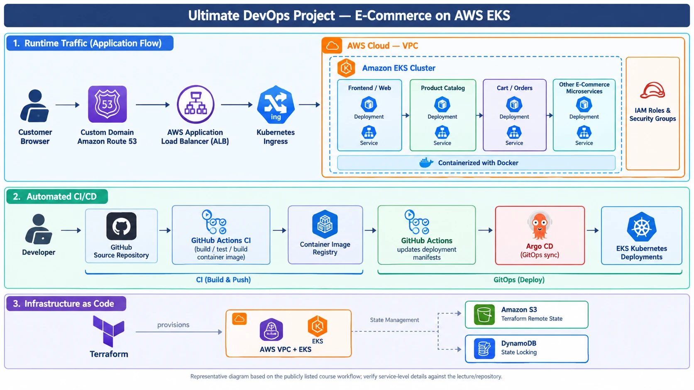
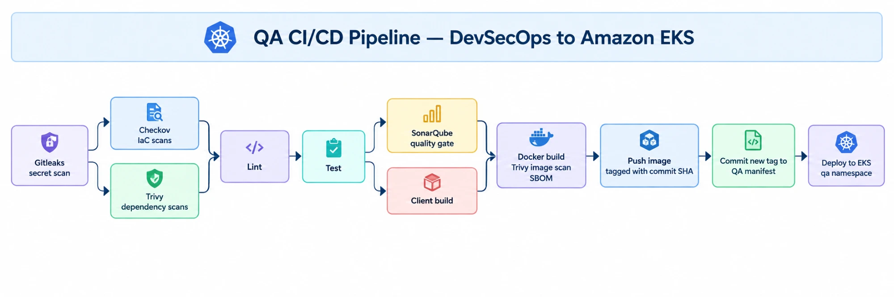

# 3-Tier User Platform on AWS EKS

A three-tier user management app (React → Node.js/Express → MySQL) deployed to **Amazon EKS** through an
end-to-end **DevSecOps pipeline** on GitHub Actions: security scanning at every stage, image promotion
from QA to production, keyless AWS authentication with OIDC, secrets pulled from AWS Secrets Manager,
and full observability with Prometheus, Loki and Grafana.


---

## Architecture


| Tier | Technology | Kubernetes resources |
|------|------------|----------------------|
| Presentation | React 17, Webpack | Built into the app image, served by Express |
| Application | Node.js 20, Express, REST API (`/api/users`) | `Deployment`, `Service`, ALB `Ingress` with TLS |
| Data | MySQL 8 | `StatefulSet` with an EBS-backed volume, headless `Service` |

### Planned target architecture

> **Not yet implemented.** The diagram above is what runs today. This is where the project is heading.



Planned changes from the current setup:

- **GitOps with Argo CD:** GitHub Actions will only build, scan and update manifests. Argo CD will sync them to the cluster, replacing the `kubectl apply` steps in the workflows.
- **Infrastructure as Code with Terraform:** the VPC and EKS cluster, created today with `eksctl`, will be provisioned by Terraform, with remote state in Amazon S3 and state locking in DynamoDB.

The diagram is a reference design for an e-commerce workload, so the services it shows (product catalog, cart/orders) are illustrative. This project's application remains the user platform described above.

## CI/CD pipeline

Two GitHub Actions workflows implement a QA → production promotion flow.

### QA: [`qa-cicd.yml`](.github/workflows/qa-cicd.yml), runs on every push to `qa`



- **Secret scanning:** Gitleaks runs first, so nothing else runs on a commit that leaks credentials.
- **Infrastructure scanning:** Checkov checks the Kubernetes manifests, the Dockerfile and any Terraform.
- **Vulnerability scanning:** Trivy scans client and server dependencies and the final container image (HIGH/CRITICAL).
- **Code quality:** SonarQube analysis with a quality gate.
- **Supply chain:** SPDX SBOMs are generated for the source tree and the image.
- **Manifest-driven deploys:** the pipeline writes the new image tag into `k8-manifests/qa/app-deployment.yaml`
  and commits it, so Git always records what is running. The push retries if the branch moved during the run.

### Production: [`prod-cicd.yaml`](.github/workflows/prod-cicd.yaml), runs on merge to `main` or manually

1. Pulls the image that passed QA and retags it `prod-<sha>`, so production runs an image that was already tested, not a rebuild.
2. Commits the new tag to `k8-manifests/prod/app-deployment.yaml`.
3. Checks RBAC permissions in the `prod` namespace, applies the manifests and waits for the rollout.

### Keyless AWS access with OIDC

Neither workflow stores AWS access keys. Each environment has its own IAM role that trusts GitHub's OIDC
provider, and only for its own branch:

| Workflow | IAM role | Trusted branch | EKS access |
|----------|----------|----------------|------------|
| QA | `GitHubActionsEKSDeployRoleQA` | `qa` | `AmazonEKSEditPolicy`, scoped to the `qa` namespace |
| Prod | `GitHubActionsEKSDeployRolePROD` | `main` | `AmazonEKSEditPolicy`, scoped to the `prod` namespace |

The trust policy template is in [`iam/github-oidc-trust-prod.json`](iam/github-oidc-trust-prod.json).

## Secrets management

Database credentials never live in Git or in Kubernetes manifests. The
[External Secrets Operator](https://external-secrets.io/) reads them from **AWS Secrets Manager**
(`qa/mysql-secret`, `prod/mysql-secret`) and creates the Kubernetes `Secret` that MySQL and the app use.
See [`k8-manifests/mysql/`](k8-manifests/mysql) and [`iam/eso-secrets-policy.json`](iam/eso-secrets-policy.json).

## Observability

The [`monitoring/`](monitoring) folder installs a Grafana observability stack with Helm:

- **Prometheus** (kube-prometheus-stack): cluster, node and pod metrics, Alertmanager, kube-state-metrics.
- **Loki**: log storage, backed by Amazon S3.
- **Grafana Alloy**: collects pod logs from the `qa` and `prod` namespaces and labels them by `env`.
- **Grafana**: preloaded dashboards for cluster overview, namespaces, pods, node exporter and Loki logs.

```powershell
cd monitoring
$env:GRAFANA_ADMIN_PASSWORD = "<choose-a-password>"
.\deploy.ps1
```

## Repository layout

```
.
├── client/                    React front end (built with Webpack)
├── server/                    Express REST API, also serves the built UI
├── Dockerfile                 Single image: builds the client, runs the server as a non-root user
├── k8-manifests/
│   ├── qa/                    App Deployment, Service, Ingress (qa namespace, applied by CI)
│   ├── prod/                  App Deployment, Service, Ingress (prod namespace, applied by CD)
│   ├── mysql/{qa,prod}/       MySQL StatefulSet, Service, ExternalSecret, SecretStore
│   └── cluster/               Cluster-wide resources (EBS StorageClass)
├── monitoring/                Helm values and deploy script for Prometheus, Loki, Alloy, Grafana
├── iam/                       IAM policies and the OIDC trust policy
├── .github/workflows/         QA and production pipelines
└── sonar.project.properties   SonarQube configuration
```

## Running it yourself

**Prerequisites:** an EKS cluster with the AWS Load Balancer Controller, EBS CSI driver and External
Secrets Operator installed; an ACM certificate for your domain; and these GitHub Actions settings:

| Name | Type | Purpose |
|------|------|---------|
| `DOCKERHUB_USERNAME` | Variable | Docker Hub account |
| `DOCKERHUB_TOKEN` | Secret | Docker Hub access token |
| `SONAR_TOKEN`, `SONAR_HOST_URL` | Secrets | SonarQube server |
| `AWS_ROLE_TO_ASSUME` | Secret | ARN of the QA deploy role |
| `AWS_PROD_ROLE_TO_ASSUME` | Secret | ARN of the production deploy role |

Files under `iam/` and `monitoring/` use placeholders such as `<AWS_ACCOUNT_ID>`; replace them with your
own values. The ingress manifests reference this project's ACM certificates and domains, so change those too.

**Run locally** (needs a MySQL instance):

```bash
cd client && npm install && npm run build
```

```bash
cd server && npm install && DB_HOST=localhost DB_USER=root DB_PASSWORD=<password> DB_NAME=test_db npm start
```

Then open http://localhost:5000.
